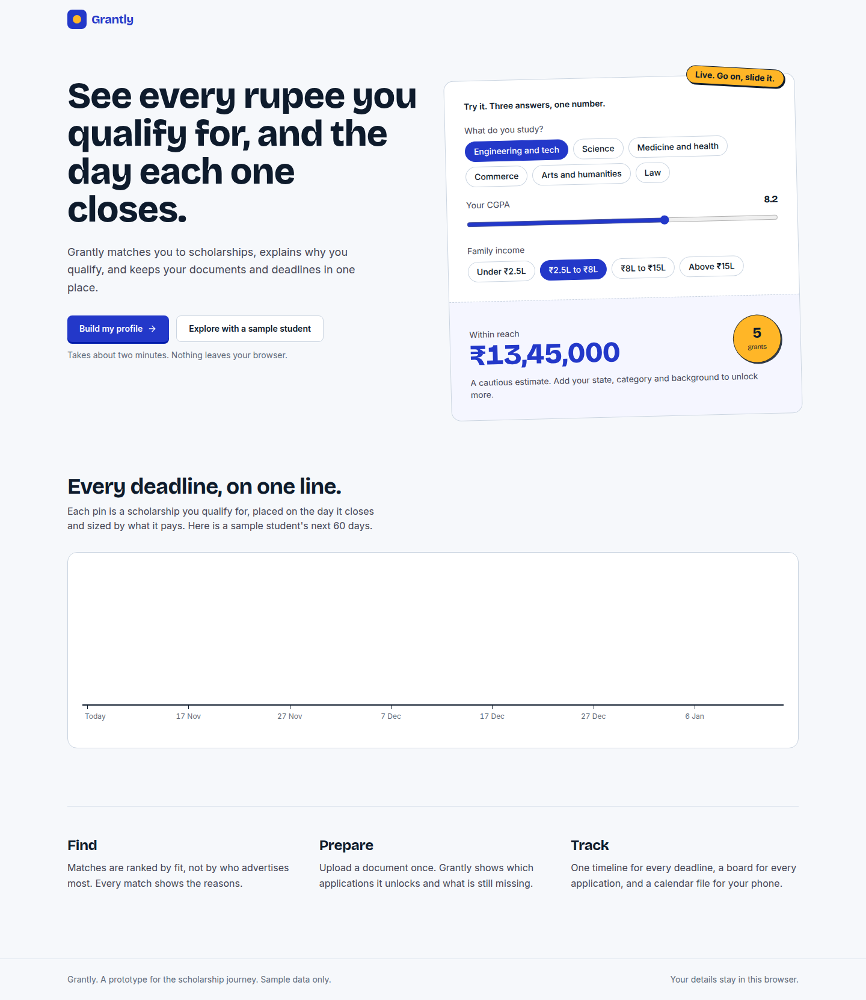
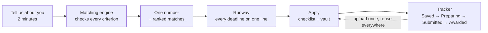
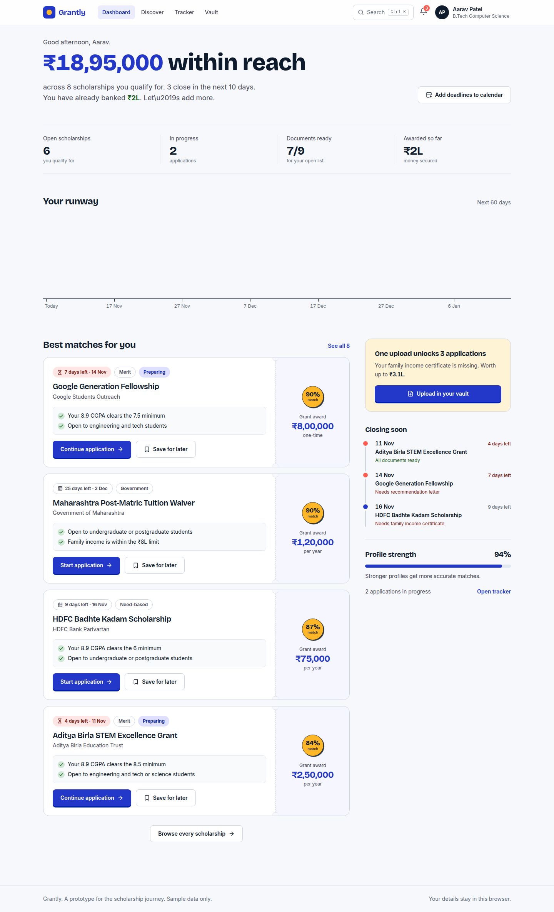
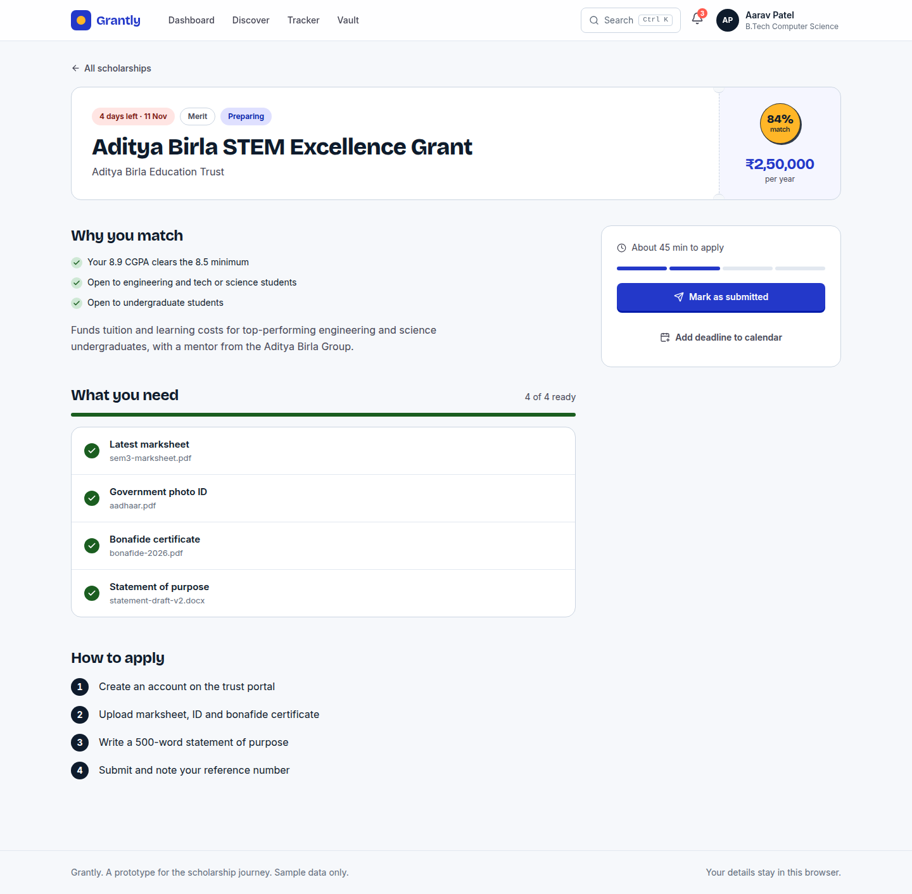
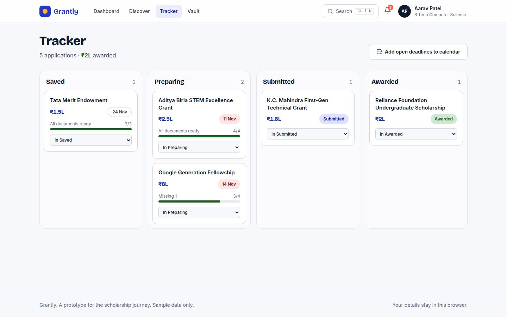
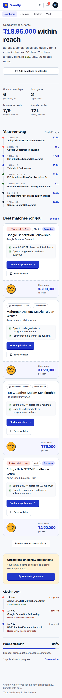

<div align="center">


# Grantly

### See every rupee you qualify for, and the day each one closes.

A scholarship companion that finds the aid you actually qualify for, explains why in plain language,<br/>and keeps your deadlines, documents and applications in one place.

<br/>

[](https://grantly-aid.vercel.app)


<br/>



<sub>Click **"Explore with a sample student"** on the live demo to see everything populated.</sub>

</div>

<br/>

## Contents

[The problem](#-the-problem) · [The idea](#-the-idea-your-funding-runway) · [Features](#-features) · [Screens](#-screens) · [How matching works](#-how-matching-works) · [60-second tour](#-60-second-tour) · [Run locally](#-run-it-locally) · [Tech](#-tech-stack) · [Quality](#-quality-notes) · [Honest notes](#-honest-notes)

<br/>

## 🎯 The problem

Getting educational financial aid is harder than it should be. A student has to:

- 🔎 **find** scholarships scattered across dozens of portals,
- 🧩 **work out** if they are eligible by decoding dense criteria,
- 📎 **gather** the right documents for every single application, and
- ⏰ **remember** deadlines that all land on different days.

Most tools are long, searchable lists. They show everything and explain nothing, so the student still does the hard part.

## 💡 The idea: your funding runway

Grantly turns that pile of information into **one answer and one timeline**.

| | |
| --- | --- |
| 💰 **One number** | The dashboard opens with what you can actually get: *"₹18,95,000 within reach"*, across the scholarships you qualify for. |
| 🛫 **One timeline** | Every match is a pin on a 60-day runway, placed on the day it closes and sized by what it pays. You see what to do first at a glance. |
| 🧾 **Reasons, not scores** | Every match explains itself (*"Your 8.9 CGPA clears the 8.5 minimum"*). Every miss does too (*"Needs a 8.5 CGPA, you have 7.9"*). |
| 📂 **Documents that work for you** | Upload once. Grantly shows which applications it unlocks and what is still missing: *"One upload unlocks 3 applications."* |

The look comes from the thing students are chasing: the **award letter**. Scholarship cards are ticket stubs with a perforated seam, and match percentages are saffron stamps.



## ✨ Features

<table>
<tr>
<td width="50%" valign="top">

**🧪 Live landing demo**<br/>
Three answers (field, CGPA, income) give a real estimate before any sign-up.

**🪄 Onboarding that explains itself**<br/>
Three short steps. Every field says why it is asked, and a live panel shows matches growing as you answer.

**🧠 Matching engine**<br/>
Checks CGPA, field, level, income slab, category, state, gender and special status, then ranks by fit.

**📊 Dashboard**<br/>
Headline amount, 60-day runway, ranked matches, closing-soon list, profile strength, and the single most valuable document to upload next.

**🔍 Discover**<br/>
Search, filter by type, amount and deadline, sort, and optionally reveal scholarships you *don't* qualify for, with the reasons.

</td>
<td width="50%" valign="top">

**📄 Scholarship detail**<br/>
Why you match, a document checklist with upload, how to apply step by step, and a *"what if your numbers were different?"* panel for near misses.

**🗂️ Tracker**<br/>
Kanban board with drag and drop, plus a keyboard-friendly "move to" menu on every card.

**🔐 Vault**<br/>
One home for documents, with expiry warnings and a count of the applications each one unlocks.

**📅 Calendar export**<br/>
Download deadlines as an `.ics` file with a reminder three days before.

**⌨️ Command palette**<br/>
`Ctrl K` / `Cmd K` jumps to any scholarship or page.

**🎉 Playful details**<br/>
Pressable buttons, award stamps, confetti when you get awarded, friendly microcopy. All motion respects `prefers-reduced-motion`.

</td>
</tr>
</table>

## 🖼️ Screens

<table>
<tr>
<td width="50%" align="center"><br/><sub><b>Dashboard</b>: the headline number and the runway</sub></td>
<td width="50%" align="center"><br/><sub><b>Scholarship detail</b>: reasons, documents, steps</sub></td>
</tr>
<tr>
<td width="50%" align="center"><br/><sub><b>Tracker</b>: drag cards across the stages</sub></td>
<td width="50%" align="center"><br/><sub><b>On a phone</b>: the runway becomes a vertical timeline</sub></td>
</tr>
</table>

## 🧠 How matching works

The engine lives in [`src/lib/engine.js`](src/lib/engine.js).

1. Each scholarship in [`src/data/scholarships.js`](src/data/scholarships.js) declares its criteria: minimum CGPA, allowed fields and levels, income ceiling, categories, states, gender and special-status flags.
2. `evaluate(scholarship, profile)` checks every criterion and returns a **plain-language verdict** for each.
3. A scholarship is **eligible** only if every criterion passes.
4. The **match percentage** starts at 70 and rises with: a bigger CGPA margin, a niche fit (special status, category or gender), a goal that matches what the student said they need, and a field-specific scholarship. It is capped at 99.
5. Deadlines are stored as *days from today*, so the demo always looks live.

<details>
<summary><b>Example: why one scholarship matches and another does not</b></summary>

<br/>

For the sample student (B.Tech CS, 8.9 CGPA, Maharashtra, OBC, income ₹2.5L to ₹8L, first-generation):

| Scholarship | Result | Reasons |
| --- | --- | --- |
| Aditya Birla STEM Excellence Grant | ✅ Eligible | 8.9 clears the 8.5 minimum · open to engineering students · open to undergraduates |
| K.C. Mahindra First-Gen Technical Grant | ✅ Eligible | income within the ₹8L limit · first-generation status met |
| Narotam Sekhsaria Postgraduate Grant | ❌ Not eligible | only for postgraduate students |
| Sashakt Medical Scholars Grant | ❌ Not eligible | only for medicine and health students |

</details>

## ⏱️ 60-second tour

1. Open the **[live demo](https://grantly-aid.vercel.app)** and drag the CGPA slider. The number changes as you go.
2. Click **Explore with a sample student**.
3. On the dashboard, find the **runway** and the *"One upload unlocks 3 applications"* card.
4. Press **`Ctrl K`**, type `tata`, press Enter.
5. Open a scholarship you are *preparing*, upload the missing document, then **Mark as submitted**. A stamp lands.
6. Open the **Tracker**, drag a card to **Awarded**. Confetti.

## 🚀 Run it locally

```bash
git clone https://github.com/AbhishekKumarCode/grantly.git
cd grantly
npm install
npm run dev
```

Build with `npm run build`, preview with `npm run preview`.

<details>
<summary><b>Project structure</b></summary>

<br/>

```
src/
├─ components/   Layout, Ticket (scholarship card), Runway, Palette, shared UI
├─ data/         scholarships.js, docs.js (sample data)
├─ lib/          engine.js (matching), format.js, ics.js (calendar export)
├─ pages/        Landing, Onboarding, Dashboard, Discover, Detail, Tracker, Vault
└─ store.jsx     app state + localStorage persistence
```

</details>

## 🧰 Tech stack

| | |
| --- | --- |
| **UI** | [React 19](https://react.dev) + [Vite](https://vite.dev) |
| **Routing** | [React Router](https://reactrouter.com), hash routing so it deploys anywhere with no rewrite rules |
| **Styling** | [Tailwind CSS v4](https://tailwindcss.com) with a small token set (ultramarine, saffron, sage, coral on cool paper) |
| **Type** | Bricolage Grotesque + Inter, bundled locally with Fontsource so it works offline |
| **Icons** | [lucide-react](https://lucide.dev) |
| **Data** | No backend. Sample data plus `localStorage` |

## ✅ Quality notes

- **Responsive.** Checked for horizontal overflow on every page at 360, 390, 768 and 1024 px. The Tracker board scrolls sideways inside itself on small screens.
- **Accessible.** Visible keyboard focus, labelled controls, dialog and live-region semantics, keyboard alternatives for drag and drop, AA contrast.
- **Tested.** The main flows were click-tested end to end in headless Chrome: onboarding, applying, uploading, tracker moves (select and drag), filters, calendar download, command palette and persistence across reloads.
- **Unit tests.** `npm test` runs 16 Vitest tests for the matching engine (eligibility, reasons, scoring, totals), document tracking, formatting and upload validation. `npm run check` runs lint, tests and a production build.
- **Secure by default.** A strict Content-Security-Policy and other security headers ship in `vercel.json`. Uploads are limited to PDF, image and Word files up to 5 MB with sanitised names, text inputs have length limits, and saved data is validated before use. React escapes all rendered text, and there is no `dangerouslySetInnerHTML`. `npm audit` reports 0 vulnerabilities.

## 🤝 Honest notes

- **Sample data.** The 16 scholarships use real organisation names for realism, but the amounts, criteria and deadlines are **illustrative**. This is a prototype, not financial advice.
- **Local only.** Nothing is sent anywhere. Uploads keep only the file name, in your browser.
- **Built with AI assistance.** The UI started from a design generated in Google Stitch from a written brief, and the code was built with Claude Code. The concept, decisions and review are the author's.

<div align="center">
<br/>

Built for a frontend hackathon on the theme **Rethinking the Scholarship Experience**.

</div>
